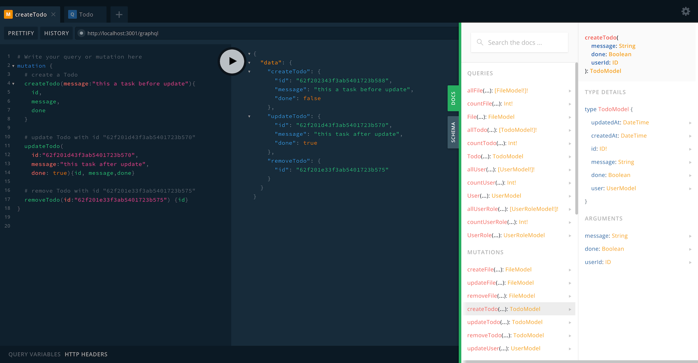
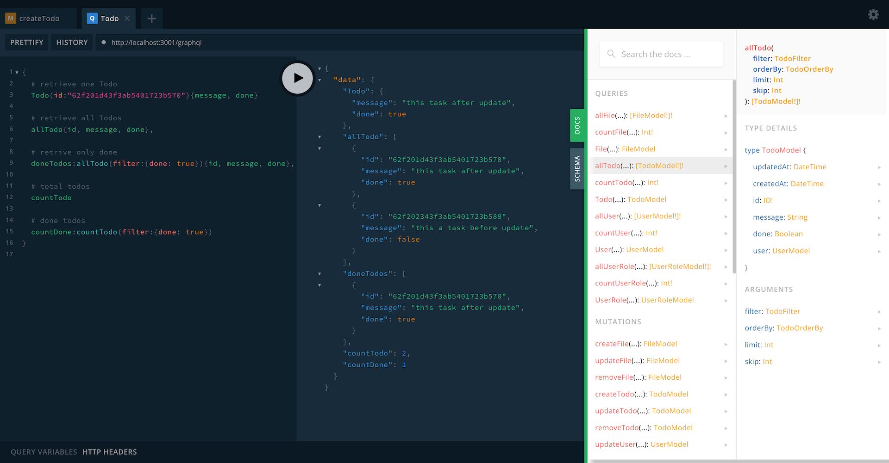
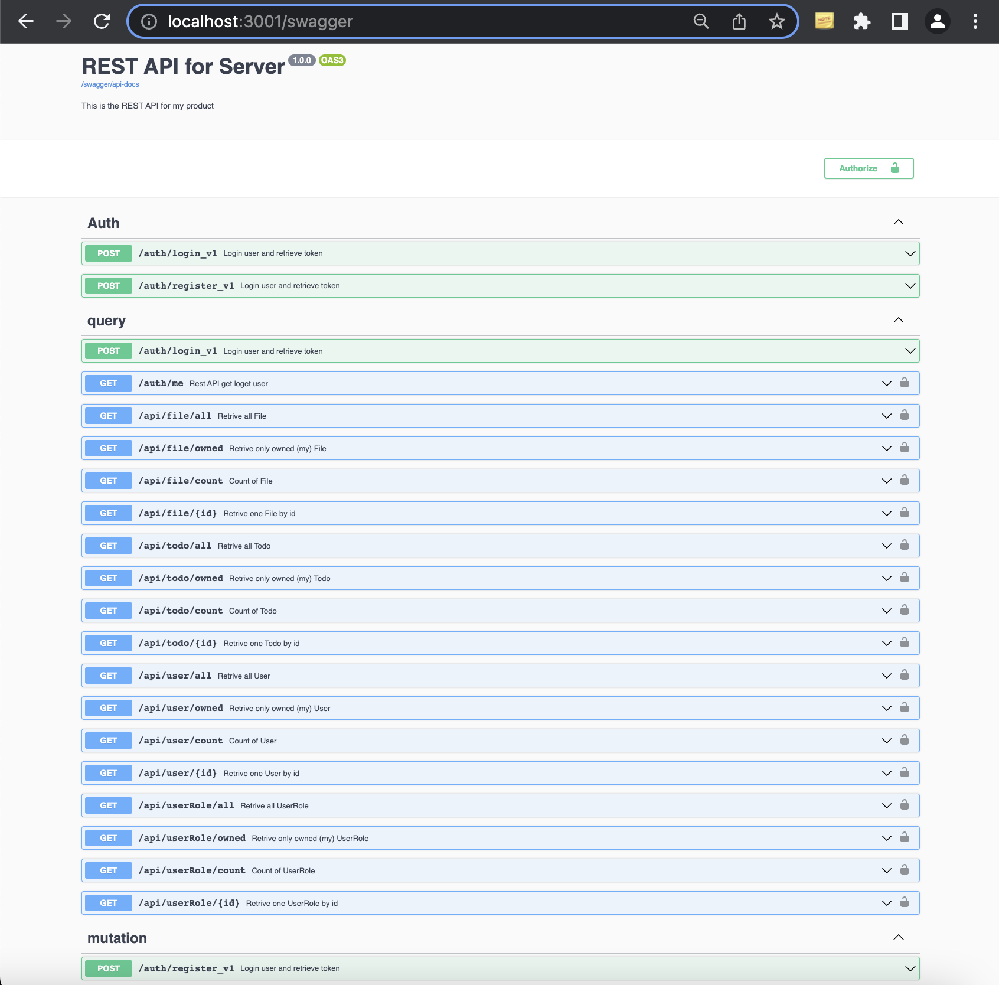

# GraphQL Monster Builder

Build server with CRUD with GraphQL and Rest API interface. With these features:

-   Generate server base on simple [schema file](https://github.com/miuan/graphql-monster-builder/blob/master/Schema.md)
-   Integrated authentication to secure models with [pre-defined rules](https://github.com/miuan/graphql-monster-builder/blob/master/Schema.md#model-permissions)
-   [Hooks](https://github.com/miuan/graphql-monster-builder/blob/master/Readme.md#hooks) to customize the server to your needs without breaking (re)build process
-   Integrated GraphQL documentation and Swagger for Rest API
-   Prepared [CRA templates](https://github.com/graphql-monster/cra-template-graphql-monster) for easy connect to React App (ES6 or [Typescipt](https://github.com/miuan/cra-template-graphql-monster-typescript))

# Requirements

Node.js 22.18+ (22.x), or Node.js 24.11+ (recommended) and a running MongoDB instance.
Generated servers use Apollo Server 5, GraphQL 16, Mongoose 9 and Koa 3.

## Upgrading an existing generated server

Generate into a fresh directory first. The builder preserves existing files outside
`gen/`, including `server.ts`, `services/passport.ts`, `package.json` and
`tsconfig.json`. Merge their updated versions into your application before
regenerating `gen/` and reinstalling dependencies. Preserve your environment
configuration, generated JWT secret, hooks and stored files.

Mongoose 9 uses promise-based database APIs. Custom hooks that call Mongoose
must replace removed APIs such as `remove`, `count` and `findByIdAndRemove`
with `deleteMany`/`deleteOne`, `countDocuments` and `findByIdAndDelete`.
Database update results now expose `modifiedCount` instead of `nModified`.
The test scripts enable Jest VM module support for the MongoDB driver's dynamic imports.

Keep the `overrides` (npm) and `resolutions` (Yarn) entries when merging the
generated `package.json`. Swagger JSDoc 6.3 pins an older vulnerable `glob`;
these entries replace only its copy with patched `glob` 14.0.4 or newer.
Remove this targeted replacement once Swagger JSDoc itself depends on a patched version.

## Development checks

Use Node.js 22.18+ within the 22.x line, or Node.js 24.11+.

```sh
yarn lint
yarn lint:fix
yarn test --runInBand
yarn prettier-format
```

ESLint uses `eslint.config.cjs`. It checks generator source and tests, excluding
`dist/` and code templates. Existing style and unused-variable cleanup items are
reported as warnings; errors fail the command. `lint` checks files, and `lint:fix`
applies available fixes. Prettier 3 runs separately with `.prettierrc.js`.
The default test run uses two workers. To run only unit tests without MongoDB, use
`yarn test:unit`; HTTP/database tests run with `yarn test:integration`. Add
`--runInBand` for a sequential run.

Integration tests bind automatically assigned ports and use isolated generated
files and database names for each run and worker. They ignore the application's
`PORT` and `DB_NAME`; `DB_HOST` can select the MongoDB host. Global teardown removes
only the test databases recorded for that run. Unit fixtures use temporary directories
and the real schema parser. Lint rejects committed `.only` tests.

The generated Jest configuration registers the jest-extended 7 matchers explicitly.
The builder also targets patched `minimatch` versions for ESLint and the TypeScript
parser using npm overrides and Yarn resolutions until those tools update their dependencies.

# Usage

```
$ graphql-monster-builder <operation> <schema> <outdir>
```

## Example

Example of simple todo server. Create [Schema File](https://github.com/miuan/graphql-monster-builder/blob/master/Schema.md) file with name `todo.schema` and folowing content in your local directory.

_Note: Be sure on your system is running instance of [MongoDB](https://www.mongodb.com/)_

```graphql
@all(filter:"user_every.id={{userId}}")
@create("public") @one("public") @update("public") @remove("public")
type Todo @model {
  message: String
  done: Boolean @default(false)
}
```

Then run these command to actual create graphql-monster-server to directory with name `todo-server`

```
npx graphql-monster-builder --backend todo.schema todo-server

# or

npm i -g graphql-monster-builder
graphql-monster-builder --backend todo.schema todo-server
```

Now you should just move to `todo-server` directory and run generated server

```
cd todo-server/ && yarn && yarn start
```

The builder automatically creates a random 256-bit `JWT_TOKEN_SECRET_GEN` in
`config/environment/.env.defaults`. This file is excluded from Git and preserved
when regenerating the server, so tokens remain valid across restarts and rebuilds.
Keep the file private and include it when moving an existing server.

To supply your own secret, set `JWT_TOKEN_SECRET` in `config/environment/.env`
or in the process environment. It takes precedence over `JWT_TOKEN_SECRET_GEN`.
Use the same secret across all instances of the same service.

Access tokens expire after one hour; refresh tokens expire after
365 days and rotate on refresh. Refresh tokens cannot authenticate API requests.
After upgrading and regenerating an existing server, users must log in again:
older tokens do not contain the required token type.

The bootstrap administrator is configured with `ADMIN_EMAIL` and `ADMIN_PASSWORD`
in `config/environment/.env` or the process environment. Without those values,
both default to `admin@graphql.monster`. Set your own values for a deployed server:

```dotenv
ADMIN_EMAIL=admin@example.test
ADMIN_PASSWORD=your-private-password
```

Plaintext `ADMIN_PASSWORD` values are hashed with bcrypt before database storage.
Existing bcrypt hashes are also accepted and preserved. The configured admin
account and password are synchronized on every server startup, including restarts.

Now you can check the:

-   Apollo Sandbox -> [http://localhost:3001/grapqhl](http://localhost:3001/graphql)
-   Swagger -> [http://localhost:3001/swagger](http://localhost:3001/swagger)

## GraphQL

Here is some examples with GraphQL mutations over `Todo` model

Here is some examples with GraphQL mutations over `Todo` model


# Rest API

The same can be acomplish with Rest API what is documented by Swagger


# Documentation

For more about schema definition, please visit our documentation:

-   [Schema Description](https://github.com/miuan/graphql-monster-builder/blob/master/Schema.md) - How create a GraphQL Monster model.
-   [Model Relations](https://github.com/miuan/graphql-monster-builder/blob/master/Schema.md#relations) - Managing model relations.
-   [Model Permissions](https://github.com/miuan/graphql-monster-builder/blob/master/Schema.md#model-permissions) – How secure particular CRUD operation of invidual model.
-   [Obtain Token (Login)](https://github.com/miuan/graphql-monster-builder/blob/master/Login.md) – How login, register user and retrieve token to access protected models.

[](https://www.youtube.com/watch?v=SE2313FeboY)

_You can check video how to create models on www.graphql.monster platform_

# Hooks

During project development You will probably very often updating the schema (adding new models or updating existing or maybe changing the protecting rules). To customize server functionality is a option of adding a hook. Hooks can be of this two type:

-   before
-   after

and can have handle these actions:

-   One (read one item)
-   All (read all items)
-   My (read all my items)
-   Create (create one item)
-   Update (update one item)
-   Delete (delete one item)

Hooks are setlet in file `entryHooks.ts` in `services/` with export object `hooks` with your defined overrides

```javascript
// example of `service/entryHooks.ts`

export const hooks = {
    services: {
        beforeTodoCreate: async (entry, todo) => {
            // do some action before Todo is stored into DB
            todo.data.message = `Created Todo: ${todo.data.message}`
            return todo.data
        },
        beforeTodoUpdate: async (entry, todo) => {
            // do some action before Todo is updated in DB
            todo.data.message = `Updated Todo: ${todo.data.message}`
            return todo.data
        },
        afterTodoCreate: async (entry, todo) => {
            // do some action after Todo is updated in DB
            return todo.data
        },
        afterTodoCreate: async (entry, todo) => {
            // do some action after Todo is updated in DB
            return todo.data
        },
    },
}
```

_Note: what is in `gen/` is have fully on control the builder generator, so what ever you will change will be in next (re)build lost!_

# Contain

-   [NodeJS](https://nodejs.org/en/)
-   [Apollo](https://www.apollographql.com)
-   [koa](https://koajs.com/)
-   [MongoDB](https://www.mongodb.com/)
-   [Swagger](https://swagger.io/)
-   [Jest](https://jestjs.io/)
